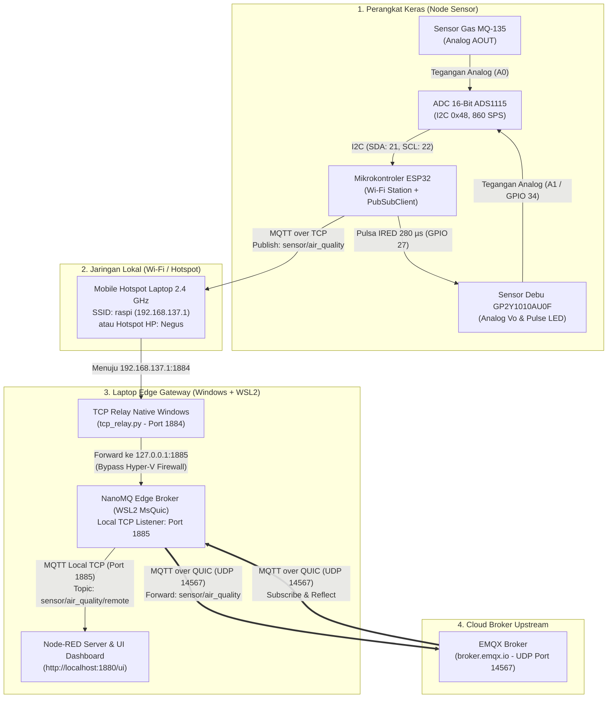
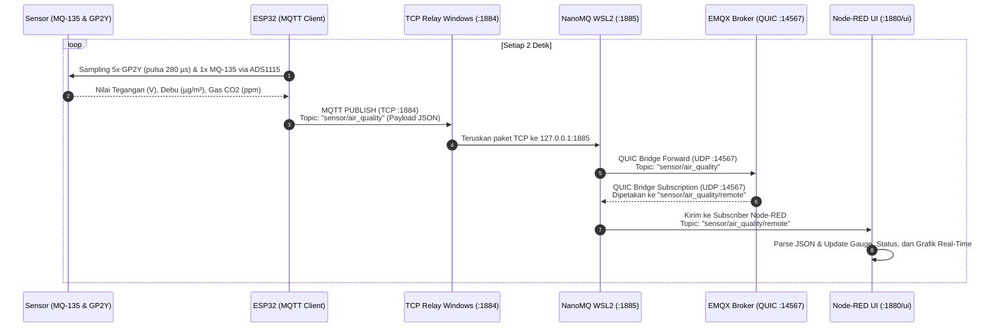

# Dokumentasi Lengkap Sistem IoT Air Quality Monitoring Berbasis MQTT over QUIC

Dokumen ini menyajikan panduan lengkap dari awal hingga akhir untuk membangun, menginstal, merangkai, mengonfigurasi, dan menjalankan sistem pemantauan kualitas udara (*Air Quality Monitoring*) menggunakan **ESP32**, sensor gas **MQ-135**, sensor debu optik **Sharp GP2Y1010AU0F**, ADC 16-bit **ADS1115**, **NanoMQ (MQTT over QUIC Bridge)**, **EMQX Cloud Broker**, dan **Node-RED Dashboard**.

---

## 1. Gambaran Umum & Mengapa MQTT over QUIC?

Pada jaringan IoT nirkabel (Wi-Fi / Hotspot Seluler), protokol MQTT standar yang berjalan di atas **TCP** sering mengalami kendala ketika kualitas sinyal berfluktuasi:
- *Handshake* TCP + TLS membutuhkan 2–3 *Round-Trip Time* (RTT) saat koneksi terputus.
- Masalah *Head-of-Line (HoL) Blocking* pada TCP menyebabkan seluruh aliran data tertahan jika satu paket hilang.

Dengan arsitektur **Edge Bridging menggunakan NanoMQ over QUIC**:
1. **ESP32** tetap menggunakan klien MQTT TCP yang ringan di jaringan lokal menuju laptop (*Edge Gateway*).
2. **Laptop (NanoMQ dengan MsQuic)** meneruskan (*bridge*) pesan ke broker **EMQX** melalui protokol **QUIC (UDP Port 14567)** yang mendukung *0-RTT/1-RTT handshake*, *multistreaming*, dan tahan terhadap *packet loss* maupun perpindahan jaringan.
3. Data yang sampai di **EMQX** ditarik kembali (*subscribe*) melalui jalur **QUIC** oleh NanoMQ dan ditampilkan secara *real-time* pada **Node-RED Dashboard**.

---

## 2. Visualisasi Arsitektur & Alur Sistem

### 2.1 Diagram Arsitektur End-to-End



---

### 2.2 Sequence Diagram Alur Pengiriman & Penerimaan Data



---

## 3. Perakitan Rangkaian Elektronik (*Hardware Wiring*)

### 3.1 Daftar Komponen yang Dibutuhkan
1. **1x ESP32 DevKit V1** (30-pin atau 38-pin) + Kabel Micro-USB / USB-C data.
2. **1x Modul ADC 16-bit ADS1115** (antarmuka I2C).
3. **1x Modul Sensor Gas MQ-135**.
4. **1x Sensor Debu Optik Sharp GP2Y1010AU0F** (6-pin).
5. **1x Resistor 150 Ω** dan **1x Kapasitor Elektrolit 220 µF** (wajib untuk rangkaian filter daya LED inframerah GP2Y1010AU0F sesuai *datasheet*).
6. Breadboard dan kabel *jumper* secukupnya.

---

### 3.2 Tabel Pinout Lengkap

#### A. Koneksi ADS1115 ke ESP32
| Pin ADS1115 | Pin ESP32 | Fungsi / Keterangan |
| :--- | :--- | :--- |
| **VDD** | `5V` / `VIN` | Catu daya 5V agar mampu mengukur sinyal sensor 0–5V |
| **GND** | `GND` | Ground bersama |
| **SCL** | `GPIO 22` | Jalur I2C Clock (Fast Mode 400 kHz) |
| **SDA** | `GPIO 21` | Jalur I2C Data |
| **ADDR** | `GND` | Mengunci alamat I2C pada `0x48` |
| **A0** | `AOUT` MQ-135 | Membaca tegangan analog dari sensor gas MQ-135 |
| **A1** | `Pin 5 (Vo)` GP2Y | Membaca tegangan analog sensor debu (mode default `USE_INTERNAL_ADC_GP2Y = false`) |

#### B. Koneksi Sensor MQ-135
| Pin MQ-135 | Terhubung ke | Fungsi / Keterangan |
| :--- | :--- | :--- |
| **VCC** | `5V` / `VIN` ESP32 | Elemen pemanas (*heater*) membutuhkan suplai 5V |
| **GND** | `GND` ESP32 | Ground bersama |
| **AOUT** | `A0` ADS1115 | Keluaran sinyal analog tegangan gas |
| **DOUT** | *Tidak dihubungkan* | Output komparator digital (tidak dipakai) |

#### C. Koneksi Sensor Debu Sharp GP2Y1010AU0F (Urutan Pin 1 s/d 6 dari Kiri ke Kanan)
| Pin GP2Y1010AU0F | Terhubung ke | Fungsi / Keterangan |
| :--- | :--- | :--- |
| **Pin 1 (`V-LED`)** | `5V` melalui **Resistor 150 Ω** | Wajib dipasang **Kapasitor 220 µF** antara Pin 1 (`+`) dan GND (`-`) |
| **Pin 2 (`LED-GND`)** | `GND` | Ground LED inframerah |
| **Pin 3 (`LED`)** | `GPIO 27` ESP32 | Kontrol pulsa LED inframerah (*Active LOW*: menyala saat `LOW`) |
| **Pin 4 (`S-GND`)** | `GND` | Ground fotodioda sensor |
| **Pin 5 (`Vo`)** | `A1` ADS1115 *(atau `GPIO 34`)* | Tegangan analog hasil pantulan partikel debu |
| **Pin 6 (`Vcc`)** | `5V` | Catu daya penguat operasional internal sensor |

---

## 4. Panduan Instalasi Semua Perangkat Lunak & Dependensi dari Nol

### 4.1 Instalasi WSL2 (Ubuntu 22.04) & Konfigurasi Jaringan
1. Buka **PowerShell (Run as Administrator)** dan jalankan:
   ```powershell
   wsl --install -d Ubuntu-22.04
   ```
2. Buat file konfigurasi `.wslconfig` di folder profil pengguna Windows (`C:\Users\<NamaUser>\.wslconfig`):
   ```powershell
   @"
   [wsl2]
   networkingMode=mirrored
   firewall=false
   "@ | Set-Content "$HOME\.wslconfig"
   wsl --shutdown
   ```

### 4.2 Instalasi NanoMQ (Versi MsQuic untuk MQTT over QUIC)
Binary NanoMQ MsQuic sudah tersedia di `bin/linux/nanomq`. Jika ingin menginstal manual di WSL Ubuntu 22.04:
```bash
wsl -d Ubuntu-22.04
wget https://github.com/nanomq/nanomq/releases/download/0.23.6/nanomq-0.23.6-linux-amd64-msquic.deb
sudo dpkg -i nanomq-0.23.6-linux-amd64-msquic.deb
```

### 4.3 Instalasi Python 3 di Windows (Untuk TCP Relay)
```powershell
winget install -e --id Python.Python.3.13
python --version
```

### 4.4 Instalasi Node.js, Node-RED, dan Dashboard UI
```powershell
# 1. Install Node.js LTS
winget install -e --id OpenJS.NodeJS.LTS

# 2. Install Node-RED secara global
npm install -g --unsafe-perm node-red

# 3. Install plugin node-red-dashboard
cd "$HOME\.node-red"
npm install node-red-dashboard
```

### 4.5 Instalasi Arduino IDE, Board ESP32, & Library Sensor
1. **Install Arduino IDE 2.x**: Unduh dari [arduino.cc/en/software](https://www.arduino.cc/en/software) atau `winget install -e --id ArduinoSA.IDE.stable`.
2. **Tambahkan Board ESP32**:
   - **File** $\rightarrow$ **Preferences** $\rightarrow$ **Additional boards manager URLs**:
     `https://raw.githubusercontent.com/espressif/arduino-esp32/gh-pages/package_esp32_index.json`
   - **Tools** $\rightarrow$ **Board** $\rightarrow$ **Boards Manager...** $\rightarrow$ Cari **`esp32`** $\rightarrow$ **Install**.
3. **Install Library di Library Manager**:
   - **`PubSubClient`** *(by Nick O'Leary)*
   - **`Adafruit ADS1X15`** *(by Adafruit)* beserta **`Adafruit BusIO`**

---

## 5. Cara Mengaktifkan Semua Layanan & Menjalankan Sistem

### Langkah 1: Jalankan Semua Layanan di Laptop
Klik dua kali **[`start_services.bat`](start_services.bat)** atau jalankan di PowerShell:
```powershell
powershell -ExecutionPolicy Bypass -File .\start_services.ps1
```
Script ini otomatis mengaktifkan:
1. **Mobile Hotspot Laptop 2.4 GHz** (`SSID: raspi`, `Pass: raspberry`, `IP: 192.168.137.1`)
2. **NanoMQ (WSL2 MsQuic)** pada port `1885` $\rightarrow$ QUIC Bridge ke `broker.emqx.io:14567`
3. **TCP Relay (`tcp_relay.py`)** pada port `1884` $\rightarrow$ `1885`
4. **Node-RED** pada `http://localhost:1880` & Dashboard di `http://localhost:1880/ui`

### Langkah 2: Upload Program ke ESP32
1. Buka [`esp32_mqtt_quic.ino`](esp32_mqtt_quic.ino) di Arduino IDE.
2. Pilih Board **ESP32 Dev Module** dan port COM ESP32 Anda.
3. Klik **Upload** dan pantau di **Serial Monitor (115200 baud)**.

### Langkah 3: Pantau Dashboard UI Node-RED
Buka browser ke **`http://localhost:1880/ui`** untuk melihat indikator koneksi QUIC, Gauge Debu ($\mu\text{g/m}^3$), Gauge Gas CO2 ($\text{ppm}$), dan Grafik Real-Time.
